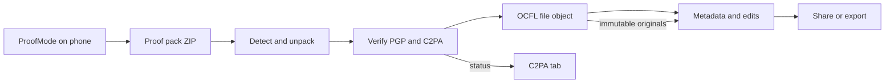

# ProofMode × FileSquid playbook

Revised 2026-10-15: names updated to the FileSquid-first model ([ADR 029](../../resources/architecture/029-filesquid-unified-product-and-distributions.md)).

**Purpose:** Two-audience playbook for a **later FileSquid milestone** (after the ImageSquid release). Humans get what ProofMode is and how it sits beside FileSquid. Agents get what to verify, store, and chain. Load [C2PA](./c2pa.md) for Content Credentials and [OCFL](./ocfl.md) for object layout.

**TL;DR:** Journalists, activists, and other serious capture users install **ProofMode on their phones**. They bring **proof packs** (ZIP + media + signatures, often with C2PA) into FileSquid (or the ImageSquid distribution). FileSquid **verifies and keeps** that capture credential, stores originals and proof in **OCFL**, and records FileSquid’s own edits, metadata, and publication as **chained later actions**. FileSquid is the library, verifier, and preservation host: the capability is a FileSquid module (`filesquid-c2pa` + `filesquid-ocfl`) behind the API, which the ImageSquid distribution may present to photo users. ProofMode is the optional capture notary. This is a **later milestone** (C-052), ordered by the owner with Arkrim and IIIF/GLAM after the ImageSquid release. It is **not** default onboarding, and it is **not** phone live-sync.[^is-vision][^pm-site]

This file records owner integration intent. It does **not** allocate new vision IDs. Shipping it still requires the vision → PRD → SRS → ADR cascade. FileSquid’s paid core remains subscription **backup and/or sync** (C-031); ProofMode integration does not replace that. Later OCFL batch jobs (C-051) are a separate value layer.

---

## Roadmap position

| When | What |
|------|------|
| **FileSquid, encrypted backup and sync, then the ImageSquid release (must ship first)** | Foundation through Release 7 / RC-001–013: library, OCFL, free import-time C2PA (FE-036), paid encrypted backup, mature consumer parity |
| **Task 9.0** | Owner chooses order of three later milestones after the ImageSquid release: Arkrim, IIIF/GLAM, ProofMode ([C-052](../../resources/product-vision.md#release-sequence)) |
| **This playbook (if ProofMode is selected)** | First-class **ProofMode pack import + verify + respect + OCFL evidence + chained enhance/export**. Vision/PRD IDs land at selection. |
| **After that slice** | Native mobile live-sync of packs remains later (C-001). PhotoKit (M-B) is already on the consumer migration track. |

**Audience for the feature:** people who already (or will) run ProofMode because their work needs capture-time proof — journalists, human-rights documenters, activists, researchers. Household camera-roll import stays the volume path (FE-028).[^is-vision]

**Three product shapes (keep them distinct):**

| Shape | Ship in this later release? | Why |
|-------|------------------------------|-----|
| Recognize / import / verify ProofMode ZIPs | **Yes — the feature** | High value; matches U-13 “prior credentials remain inspectable” |
| Mention ProofMode in advanced provenance help as optional capture | **Yes — docs** | Users who need stronger capture know where to get it |
| Require or live-sync ProofMode for every FileSquid or ImageSquid user | **No** | Fights the lifetime-library job; C-001; GPL app stays outside FileSquid |

---

# For humans

## What ProofMode is

ProofMode is a free, open-source phone app and toolkit from Guardian Project, WITNESS, and Okthanks (Capture, Verify, Identify, Connect, Enhance).[^gp-c2pa] You take a photo or video as usual (or with their camera). ProofMode attaches **proof**: a fingerprint of the file, a cryptographic signature from a key on that phone, a snapshot of device/time/optional location, and — in current 3.x apps — **C2PA Content Credentials**. You share a **proof pack** (a ZIP) so the signatures survive messaging apps.[^pm-site][^pm-android][^pm-c2pa]

Anyone can check a pack in the browser at [check.proofmode.org](https://check.proofmode.org/) (ProofCheck). Checks run on the device; the site is built to avoid uploading your media.[^pm-verify][^proofcheck-web]

ProofMode answers “these bytes were signed on this device at this time, with this extra context.” It does **not** certify that the picture depicts the truth. FileSquid’s own rules say the same about C2PA (C-018).[^is-vision]

## What FileSquid is in this pairing

FileSquid is the **long-term library**: originals on disk in OCFL, a usable grid, descriptive metadata, later edits, paid encrypted backup, and (when you ask) signed publication. Provenance for ordinary imports begins when you bring a file in (U-13, FE-036). A signature FileSquid adds later cannot pretend it was there in the camera (C-011).[^is-vision]

ProofMode supplies the **camera-side** credential FileSquid cannot invent after the fact.

## What you do

1. Install ProofMode from [proofmode.org/install](https://proofmode.org/install/) (Android; iOS via their beta/TestFlight).
2. Capture with ProofMode enabled. Use **Share Proof** (robust / C2PA when you need Content Credentials).
3. Open or drop that ZIP in FileSquid or ImageSquid (later release). FileSquid checks the signatures and C2PA, files the photo and the proof in your library, and shows an honest status (unsigned / valid / trusted).
4. Keep working in FileSquid (collections) or ImageSquid (albums): captions, Dublin Core, crops, AI tools you chose, paid C2PA publication. Share or export when ready. The original ProofMode proof stays with the original file; FileSquid’s changes are recorded as **later steps**.

FileSquid does **not** replace ProofMode’s capture certificate with a new “created by FileSquid” claim.

## Status you may see

| Status | Meaning |
|--------|---------|
| Proof pack intact | File hash matches; OpenPGP signatures check |
| C2PA Valid | Manifest is well-formed and bound to these bytes; signer may be self-signed |
| C2PA Trusted | Validator’s trust list accepts the signer (ProofMode’s Level 1 path uses their ProofSign certificate on store builds)[^pm-conform] |
| FileSquid actions | Import, metadata, edit, publish — chained after ProofMode, inspectable in FileSquid's Content Credentials panel or ImageSquid's C2PA tab |

Self-signed on-phone keys are common and still useful. “Trusted” is a certificate-list result, not a moral rating.[^pm-c2pa]

---

# For agents

## Division of labour

| Layer | Owner | FileSquid job |
|-------|--------|----------------|
| Capture-time hash, PGP, sensors, optional C2PA | ProofMode app (user-installed) | Verify; store; display |
| Canonical bytes + versions | `filesquid-ocfl` via FileSquid callers | Persist media + proof sidecars + later versions (C-044) |
| Descriptive metadata | `filesquid-metadata` | Dublin Core / Schema.org on `metadata.md`; map safe CSV fields |
| Later C2PA actions | Official [`c2pa`](https://crates.io/crates/c2pa) crate (ADR 011, 015) | `c2pa.opened` / `c2pa.edited` / `c2pa.edited.metadata` / `c2pa.published` with ProofMode asset as **ingredient**[^adr-011][^adr-015] |
| Paid trusted publication | Third-party publisher (FE-042) | FileSquid is caller, not a CA |
| Phone live-sync | Out of this release | Share-sheet / ZIP / folder import only |

## Mandatory C2PA respect (the point of this playbook)

When ingesting media that already carries a **verifiable ProofMode (or other) C2PA capture manifest**:

1. **Validate** with the official `c2pa` crate (Well-Formed → Valid → Trusted). Optional extra: `proofmode` crate `check` for ZIP/PGP/CSV.
2. **Keep the capture manifest immutable** (FE-037). Store original bytes; do not strip, resign, or rewrite the capture claim.
3. **Treat ProofMode as the origin credential.** FileSquid MUST record import as `c2pa.opened` (or equivalent update) with `c2pa.ingredient` / parentOf pointing at that manifest. FileSquid MUST NOT emit `c2pa.created` for that capture.
4. **FE-036 still holds** as a *lifecycle*: every import has durable, inspectable C2PA/PROV-O history. For these files the lifecycle **continues** the ProofMode chain rather than minting a new origin.
5. Unsigned prepared FileSquid records stay distinct from Valid/Trusted (FE-038, C-011).[^is-vision]

When the pack has PGP/CSV **without** a C2PA manifest: keep the pack as evidence sidecars; start FileSquid’s import lifecycle on the media (`c2pa.opened` of unsigned bytes). Do not claim ProofMode C2PA where none exists.

## Target workflow (later release)

| Step | Agent MUST |
|------|------------|
| **Detect** | Recognize ProofMode ZIP (hash-named `.proof.csv` / `.proof.json`, `.asc`, `pubkey.asc`, optional `.ots`/`.gst`, optional embedded C2PA). Accept unpacked folders. |
| **Verify** | SHA-256 of media vs CSV; OpenPGP over media and CSV; C2PA validation states; optional consistency across a batch. Use `proofmode` 0.9+ `check` **or** equivalent in-process (Apache-2.0).[^pm-rust][^pm-verify] |
| **Store** | One OCFL object for the file bytes; proof members as versioned evidence sidecars; C2PA store remains file-bound. Callers own ProofMode layout; `filesquid-ocfl` stays generic OCFL 1.1 (C-044). |
| **Respect** | Origin credential = ProofMode when Valid/Trusted; FileSquid actions are later manifests. |
| **Describe** | Map non-sensitive proof fields via `filesquid-metadata`; GPS/cell/IP follow F-046 disclosure profile. |
| **Enhance** | Crops, captions, AI (BYO), watermarks: new version + chained C2PA action. Pixel/bitstream change ⇒ new derivative (C-012). |
| **Share / export** | Outgoing file keeps prior credentials; FileSquid adds only the actions it performed; paid publish may add publisher signature + watermark; Article 50 visible label remains a separate duty (C-016). |

## Proof pack schema (ingest contract)

Share output is a ZIP so messengers cannot crush signatures.[^pm-verify]

| Member | Store as |
|--------|----------|
| Media (JPEG/MP4/…) | OCFL content file (canonical bytes) |
| `{sha256}.proof.csv` / `.proof.json` | Evidence sidecar |
| `{sha256}.asc`, `{sha256}.proof.csv.asc`, `pubkey.asc` | Evidence sidecar |
| `{sha256}.ots`, `{sha256}.gst` | Evidence sidecar (parse; **not** a product SKU) |
| Embedded C2PA | Stays in the media file; inspector reads it |

JSON schema 1.0.25 **required:** `File Path`, `Hardware`, `Proof Generated`, `DataType`, `File Hash SHA256`. Optional: manufacturer, locale, language, IPv4/IPv6, network/cell, screen, device IDs, location.* [^pm-schema]

\* Location, cell, and IP are sensitive. Honor ProofMode’s own omission of fields and FileSquid disclosure profiles.

## What to integrate (code)

| Integrate | License | How |
|-----------|---------|-----|
| Official `c2pa` crate | Apache-2.0 (CAI) | **Only** C2PA read/validate/write path (ADR 011 / 015)[^adr-011] |
| `proofmode` crate 0.9.x | Apache-2.0 | Optional worker: ZIP preprocess, PGP, OTS parse, batch consistency. Feature-gate. Default features pull sequoia + polars — trim if too heavy.[^pm-rust] |
| ProofMode v1 schema + sample media | schema / CC BY docs | Test vectors for ZIP detect and field map[^pm-schema][^pm-conform] |
| C2PA trust lists | C2PA / CAI | Configure so ProofMode Level 1 / ProofSign certs can report **Trusted** when authentic; self-signed stays **Valid** |
| `proofmode-c2pa-mcp` / Claude C2PA skill | MIT / Apache-2.0 | Optional BYO-agent path wrapping `c2patool`; prefer in-process `c2pa` in the desktop worker[^mcp][^claude-skill] |

| Leave outside the MIT link graph | License | Use instead |
|----------------------------------|---------|-------------|
| `proofmode-android` | GPL-3.0 | User installs the app; FileSquid reads **files** |
| `proofcheck-web` | AGPL-3.0-or-later | Reimplement inspector UX in Tauri; study worker design[^proofcheck-web] |
| SimpleC2PA as FileSquid writer | Apache-2.0 but `c2pa` **0.48** `v1_api` | CAI crate current; later mobile: `c2pa-android` / `c2pa-ios`[^simple-c2pa][^pm-build] |
| libProofMode | Legacy | Crate / CAI SDKs |
| OpenTimestamps productization | in packs | Parse `.ots` only |
| IPFS/Filecoin Baseline | Preserve docs | Paid core remains encrypted OCFL[^pm-preserve] |

Canonical ProofMode code: GitLab `guardianproject/proofmode`. GitHub `guardianproject/proofmode-android` is a **mirror**. The GitHub org also hosts unrelated Tor/Haven apps.[^pm-gitlab][^gp-github]

## ProofMode C2PA facts agents need

| Topic | Fact |
|-------|------|
| Spec | ProofMode 3.x claims C2PA **2.3**; FileSquid ADRs cite **2.4** — interop is standard manifests[^pm-android] |
| Conformance | Android generator Max Assurance **Level 1** (April 2026)[^pm-conform] |
| Local sign | On-device self-signed content-credentials cert |
| Trusted sign | ProofSign remote; sideloaded APK cannot use the store trusted cert |
| Assertions | `c2pa.created` / actions; `c2pa.metadata`; optional training-and-data-mining (“Block AI”); optional location[^pm-ai] |
| Dual evidence | Historical design: unmodified media + sidecar PGP/CSV. 3.x robust share may also embed C2PA (possibly a derivative). Ingest both channels. |

## Enhancement and export rules

| FileSquid action | C2PA / OCFL |
|-------------------|-------------|
| Import verified pack | New OCFL version 1 = original + proof sidecars; C2PA update `opened` + ingredient |
| Caption / Dublin Core | `c2pa.edited.metadata` if signed; `metadata.md` always (FE-070) |
| Crop / filter / transcode | New derivative version; `c2pa.edited` / `c2pa.transcoded`; hard-bind new bytes |
| Material AI (FE-010) | Record action + machine-readable AI mark on retained derivative |
| Paid publish (FE-042) | Publisher-signed derivative + watermark; keep private original |
| Training opt-out | Preserve ProofMode mining assertion; user may add/keep on export |
| Batch share | One ZIP in ⇒ many OCFL objects; consistency layer MAY flag mixed devices |

## Inspector copy (reuse ProofMode’s three layers)

| Layer | Question | FileSquid surface |
|-------|----------|-------------------|
| Integrity | Hashes and signatures OK? | C2PA tab + proof sidecar status[^pm-three] |
| Consistency | Does this batch agree with itself? | Collection scan (later) |
| Synchrony | Does it match the claimed event? | Optional, user-interpreted; FileSquid does not score “truth” |

ProofCheck AI chips (filename + EXIF + C2PA actions) are heuristics. Surface them as hints if reimplemented; C-018 forbids marketing them as legal AI/non-AI proof.[^pm-checkai]

## Agent rules (MUST)

1. Place this work **after the ImageSquid release** (FileSquid, then encrypted backup and sync, then ImageSquid) and only after Task 9.0 selects ProofMode. Do not insert it ahead of Foundation–Release 7, and do not treat it as automatically next versus Arkrim or IIIF/GLAM.
2. Allocate vision/PRD IDs **before** coding (owner cascade). This playbook is not a substitute SRS.
3. GitLab is canonical for ProofMode source.
4. Link only Apache-2.0 / MIT ProofMode libraries. GPL Capture and AGPL ProofCheck stay out of FileSquid crates.
5. C2PA read/write/validate = official `c2pa` crate. `proofmode` crate = pack/PGP helpers only.
6. Verifiable ProofMode C2PA ⇒ **respect as origin**; FileSquid actions chain; never `c2pa.created` for that capture.
7. Show Well-Formed / Valid / Trusted honestly. Self-signed ≠ Trusted unless the trust list says so.
8. Original media and proof sidecars remain immutable OCFL content. Enhancements are new versions.
9. Parse `.ots` / `.gst`; do not add OpenTimestamps or blockchain SKUs to vision, PRD, architecture, or plans.
10. Device attestation and C2PA are provenance evidence. They do not prove depicted truth or Article 50 first-exposure disclosure.
11. GPS/cell/IP follow F-046. Empty ProofMode fields mean the user omitted them — do not backfill.
12. `filesquid-ocfl` remains a generic engine. ProofMode paths live in FileSquid callers.
13. Re-check crate versions, ProofSign certs, and GitLab activity before implementation (`stale_after` 2027-03-27).

---

## Quick decision table

| Question | Answer |
|----------|--------|
| Who installs ProofMode? | The user, on their phone. FileSquid never ships that GPL app. |
| Default capture for all users? | No. Optional path for journalists, activists, researchers. |
| Live-sync from phone? | Out of this release. ZIP / share / folder import. |
| Does FileSquid mint a new capture C2PA? | No when a verifiable ProofMode (or other) capture manifest exists. It verifies, stores, and chains. |
| Where do bytes live? | OCFL file object + proof sidecars; paid backup is still encrypted OCFL. |
| What does FileSquid add? | Verify UI, preservation, metadata, edits, export/publish — as later provenance. |
| C2PA SDK? | Official `c2pa` crate. |
| Pack/PGP helper? | Optional `proofmode` 0.9.x Apache-2.0. |
| Trusted vs Valid? | Trusted = trust-list (ProofSign Level 1). Valid = crypto OK, often self-signed. |
| OpenTimestamps? | Sidecar only. RFC 3161 TSA remains the paid timestamp. |
| Article 50? | Unchanged: C2PA/watermarks/badges are not the human-perceivable label. |

[^pm-site]: ProofMode website
[^gp-github]: Guardian Project GitHub organization
[^pm-gitlab]: Canonical ProofMode GitLab group
[^pm-android]: ProofMode Android README (GitHub mirror of GitLab)
[^pm-rust]: proofmode-rust README and crates.io proofmode 0.9.0
[^simple-c2pa]: Simple-C2PA Rust library README
[^pm-build]: ProofMode developer SDKs (SimpleC2PA, CAI mobile, libProofMode)
[^pm-verify]: ProofCheck verification docs
[^pm-ai]: ProofMode AI safety, Block AI, MCP, Claude skill
[^pm-c2pa]: ProofMode and C2PA overview
[^gp-c2pa]: Guardian Project Proofmode and C2PA
[^pm-three]: Three-layer verification (integrity, consistency, synchrony)
[^pm-schema]: ProofMode v1 JSON schema 1.0.25
[^pm-conform]: ProofMode C2PA Conformance documentation
[^proofcheck-web]: proofcheck-web README and package.json
[^mcp]: ProofMode C2PA MCP server README
[^claude-skill]: Claude C2PA skill README
[^pm-preserve]: ProofMode Preserve / Baseline IPFS-Filecoin process
[^pm-checkai]: Generative AI detection in ProofCheck
[^is-vision]: FileSquid product vision (C2PA import, OCFL, disclosure)
[^adr-011]: ADR 011 official c2pa crate
[^adr-015]: ADR 015 PROV-O JSON-LD and c2pa crate
