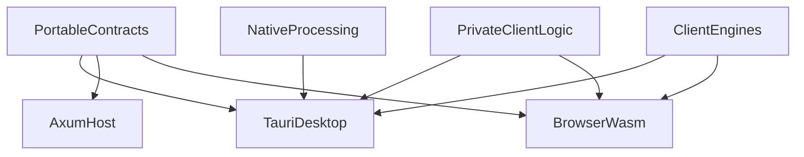

# Architecture Decision Record - FileSquid

001-shared-rust-core-with-tauri-and-axum-hosts.md

## Title

Shared Rust application libraries with Tauri desktop, Axum hosted, and WebAssembly browser hosts

## Status

Accepted

Accepted: 2026-09-16T01:01:07Z. Revised: 2026-09-25T21:00:00Z. Revised: 2026-10-15T03:34:43Z. Amended by [ADR 025](./025-client-side-filesquid-engines.md): the client engines `filesquid-ocfl` and `filesquid-metadata` link into Tauri and browser WASM, never Axum.

Amended 2026-10-15 by [ADR 029](./029-filesquid-unified-product-and-distributions.md), [ADR 030](./030-filesquid-api-and-transports.md) and [ADR 032](./032-hosting-and-privacy-model.md): hosts link `filesquid-api`, which owns the versioned operation schemas; Axum is now also the owner-operated, multi-user `filesquid-server`, which MAY link the modules. The "portable contracts only" rule now applies to the ciphertext-only `*.filesquid.tech` service. The UI language is vanilla TypeScript ([ADR 031](./031-vanilla-typescript-ui-and-white-label-theming.md)). `imagesquid_core` is now `filesquid-core` at `apps/filesquid/crates/core/`.

## Context / Requirement Reference

FileSquid MUST be a local-first photo and video manager with an independent browser application that works when every desktop is off ([FE-001](../product-vision.md#independent-library), [FE-017](../product-vision.md#cross-platform-access), [T-002](../product-vision.md#client-processing-and-hosted-mailbox)). High performance is a free-core requirement ([U-11](../product-vision.md#platform-ownership-and-access), [T-010](../product-vision.md#performance-acceptance)). Hosted preservation MUST NOT see library keys or ordinary private plaintext ([T-001](../product-vision.md#client-processing-and-hosted-mailbox), [U-20](../product-vision.md#one-api-hosts-and-distributions), [FE-033](../product-vision.md#portable-preservation)).

The source documents listed TypeScript, Tauri 2/Rust and SQLite as **design candidates**, and Phoenix/Elixir as a hosted candidate. Investigations of Phoenix LiveView, FastAPI and a mixed Elixir-plus-Rust desktop sidecar would have produced two or three application backends for one product. The owner required one systems language, one UI language, and no redundant similar technologies.

## Decision

FileSquid uses **Rust** for application logic and **TypeScript** (vanilla, without Svelte, [ADR 031](./031-vanilla-typescript-ui-and-white-label-theming.md)) for the interface. Reusable code sits in shared Rust libraries **outside** both delivery frameworks. Cargo features MUST NOT be the only boundary: features are additive and can be enabled through other crates ([Cargo feature unification](https://doc.rust-lang.org/cargo/reference/features.html#feature-unification)). Implementation MUST use **separate libraries** with explicit executable dependencies:

| Library family | Owns | Linked into |
|---|---|---|
| Portable contracts | Versioned operation schemas, errors, envelopes, opaque IDs, job/progress types | Tauri, Axum, WASM |
| Private client logic | Catalog/search, replica queries, private metadata meaning | Tauri and WASM only |
| Client engines | OCFL (`filesquid-ocfl`, [ADR 016](./016-rust-ocfl-library.md)), metadata (`filesquid-metadata`, [ADR 024](./024-filesquid-metadata-engine.md)) and C2PA (`filesquid-provenance`, [ADR 026](./026-filesquid-provenance-engine.md)); storage backends are injected by the host ([ADR 025](./025-client-side-filesquid-engines.md)) | Tauri and WASM only |
| Native processing | Local filesystem backend, SQLite, libvips, FFmpeg, OS adapters | Tauri only |

- **Desktop:** Tauri depends on all four families. The interface calls Rust through Tauri IPC. There is no local web server ([ADR 002](./002-tauri2-desktop-shell.md)).
- **Owner-operated server:** `filesquid-server` (Axum) links `filesquid-api` and the modules and MAY process plaintext ([ADR 032](./032-hosting-and-privacy-model.md)).
- **Hosted (`*.filesquid.tech`):** the ciphertext-only service depends **only** on portable contracts: crypto envelopes, opaque IDs, job/progress protocol types, ciphertext transport, account/device/billing contracts. It MUST NOT depend on private client logic, the client engines (`filesquid-ocfl`, `filesquid-metadata`, `filesquid-provenance`) or native processing. It MUST NOT compile or run private collection search, plaintext catalog queries, or libvips/FFmpeg on private originals. CI MUST fail the hosted build if prohibited native components appear in the dependency graph. It MAY serve the already-built UI as **static files** ([ADR 004](./004-axum-hosted-ciphertext-mailbox.md)).
- **Browser:** Private client logic, the client engines and portable contracts compile to WebAssembly ([ADR 008](./008-browser-wasm-scope.md), [ADR 025](./025-client-side-filesquid-engines.md)). Native processing does not. Compiling to WebAssembly does not make desktop APIs available in a browser.

Versioned operation schemas and errors are owned by the portable-contracts library. TypeScript and WASM MUST consume that same schema (generated bindings or equivalent), with compatibility tests so desktop/browser protocol cannot drift. Sharing structs without a versioned schema is insufficient.

Phoenix, LiveView, FastAPI, Django and Python sidecars MUST NOT be introduced as additional application backends.

## Rationale

The hard work is in Rust: OCFL, hashing, encryption, catalogs, media workers and platform adapters. Rust owns that work on the desktop, and the browser-safe part of it (OCFL and metadata engines, hashing, envelopes) also runs as WASM. Using the same libraries for hosted transport types and browser-safe crypto avoids a second FastAPI or Phoenix implementation of the same rules.

Tauri and Axum are **hosts**, not competing products. Both call the libraries. The Svelte UI is the same client in the webview and in an ordinary browser. That is the minimum set that still satisfies local-first desktop, independent web, and hosted encrypted backup.

A LiveView or FastAPI layer would re-implement orchestration without replacing Rust workers, and would pressure the hosted path to see private content.

## Assumptions

- The team will maintain Rust and TypeScript, not a third application language.
- Per-OS installers are acceptable; a single binary for all operating systems is not required.
- The hosted service can stay ignorant of file meaning if clients decrypt locally.
- Foundation measurements on Linux desktop and independent browser will validate the performance contract ([ADR 007](./007-durable-jobs-and-interactive-performance.md)).
- Exact crate versions are recorded in implementation lockfiles, not in this ADR.

## Alternatives Considered

- **Phoenix/LiveView locally and hosted:** Viable as a sidecar, but adds a BEAM runtime beside Tauri, splits orchestration, and cannot render private hosted state without breaking privacy. Rejected.
- **FastAPI plus vanilla HTML:** A second language for a control plane that still cannot own desktop media work; vanilla pages under-build collection browse. Rejected as the application architecture.
- **Electron or Flutter as the shell:** Electron wastes memory against FileSquid U-11; Flutter does not share a real browser UI. Rejected in the desktop-shell discussion; see [ADR 002](./002-tauri2-desktop-shell.md).
- **All-Rust UI (Dioxus/Leptos):** Would fight WCAG, webview/browser media, and the independent browser product. Rejected.
- **Separate backends per surface:** Forbidden by the no-redundancy rule.

## Consequences / Implications

Easier: one domain model; one job protocol; one crypto envelope; desktop and hosted teams share **contracts**, not one mega-crate. Harder: workspace layout and CI exclusion checks must exist before Axum or WASM land; sharing a type is not permission to run that logic on the server. WASM is a subset, not a full desktop. Native media libraries still need per-OS builds ([ADR 006](./006-libvips-native-stills-not-imagemagick.md)). The inherited BEAM template in this repository is not the product stack. Acceptance of this stack is **implementation direction**. It does not satisfy FileSquid U-11 until [ADR 007](./007-durable-jobs-and-interactive-performance.md) measurements pass.

## Related Decisions / Notes

- [ADR 002](./002-tauri2-desktop-shell.md), [ADR 003](./003-svelte-client-rendered-ui.md), [ADR 004](./004-axum-hosted-ciphertext-mailbox.md), [ADR 005](./005-sqlite-local-postgres-hosted.md), [ADR 006](./006-libvips-native-stills-not-imagemagick.md), [ADR 007](./007-durable-jobs-and-interactive-performance.md), [ADR 008](./008-browser-wasm-scope.md), [ADR 016](./016-rust-ocfl-library.md)
- Upstream crates verified at writing: Axum 0.8.x, SQLx 0.9.x, Tauri 2.11.x (Tauri 3 was alpha; this decision is Tauri **2**), official `c2pa` crate (now a CI oracle only; [ADR 026](./026-filesquid-provenance-engine.md)). Pin exact versions at first implementation.
- No application workspace is scaffolded by this record.
